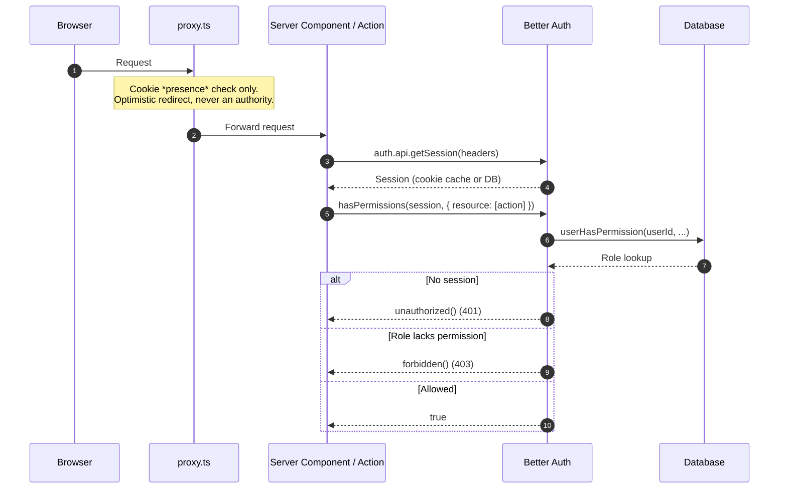

# Authentication & Authorization

This document covers the identity model, session lifecycle, caching boundaries, and Role-Based Access Control (RBAC) for the HackKU platform. Read it before touching anything under `lib/auth/`, `proxy.ts`, or any Server Action that needs a permission check.

| Concern | Source of truth |
| :--- | :--- |
| Server configuration, `hasPermissions` | [`lib/auth/auth.ts`](../lib/auth/auth.ts) |
| Client helpers (`useSession`, `authClient`) | [`lib/auth/auth-client.ts`](../lib/auth/auth-client.ts) |
| Permission statements and roles | [`lib/auth/permissions.ts`](../lib/auth/permissions.ts) |
| Optimistic redirects | [`proxy.ts`](../proxy.ts) |
| Tables | [`db/schema.ts`](../db/schema.ts) |

> [!NOTE]
> Items marked **Status** describe how the code behaves *today*, which can differ from the intended policy. They are collected under [Known Gaps](#known-gaps).

## Architecture Overview

HackKU uses [Better Auth](https://www.better-auth.com) as its authentication library. Identity centers on a single canonical `User` record tied to a unique email address.



### Key Constraints

* **Canonical identity:** Email addresses are unique across all authentication methods.
* **Unified sign-in and sign-up:** There is one flow; unknown emails get an account automatically.
* **Passkeys are secondary:** A passkey can only be registered by an already-authenticated user.
* **Admin security:** Admins must use two-factor authentication (TOTP). See the **Status** note under [Two-Factor Authentication](#4-two-factor-authentication).

### Enabled Better Auth Features

| Feature | Configuration |
| :--- | :--- |
| Email OTP | Codes expire after **10 minutes**; delivered through Resend. |
| Social OAuth | Google, GitHub, Discord. |
| Generic OAuth | MyMLH (`providerId: "mymlh"`). |
| Passkeys | Relying party `hackku.org`. |
| Two-factor | TOTP, with `allowPasswordless: true`. |
| Admin plugin | Roles from `permissions.ts`; default role `hacker`. |
| Organization plugin | Used for hacker teams and mass-registration groups. |
| Custom session | Copies `role` and `isRegistered` onto `session.session`. |

## Authentication Flows

### 1. Unified Sign-In / Sign-Up

If the email does not exist during an Email OTP or OAuth attempt, a new `User` is created automatically.

> [!NOTE]
> GitHub and Discord accounts without a public email get a synthetic address (`<id>@placeholder.github.com` or `<id>@placeholder.discord.com`). These pass the uniqueness constraint but cannot receive email.

### 2. Account Linking

A user may have several sign-in methods. Linking is restricted:

| Situation | Result |
| :--- | :--- |
| Signed in and linking another provider | Allowed. |
| Signed out, and the provider returns an email that already has a **linked** account | **Rejected** with "Please sign in with an account already linked to your profile." |
| Signed out, and the matching `User` has **no** linked accounts (an "orphaned" record) | Allowed; the new account is attached. |

`google`, `github`, `discord`, and `mymlh` are trusted providers for linking. The orphan exception is temporary and should be removed once every user has a linked account (see the comment in `lib/auth/auth.ts`).

### 3. Passkey Authentication

Unauthenticated users cannot create an account with a passkey alone. They must first authenticate with Email OTP or OAuth, then register the passkey from their account settings.

### 4. Two-Factor Authentication

* Any user may optionally register a TOTP authenticator.
* **Policy:** accounts with the `admin` role cannot perform administrative operations until 2FA is configured and verified.

> [!WARNING]
> **Status:** no code under `app/`, `lib/`, or `components/` currently reads `twoFactorEnabled`. Admin 2FA is therefore a policy, not yet an enforced check. See [Known Gaps](#known-gaps).

## Session Management

### Session Lifecycle

| Property | Value | Meaning |
| :--- | :--- | :--- |
| Lifetime | 7 days | A session expires 7 days after it was last extended. |
| Refresh interval | 24 hours | If a request arrives and the session was last extended more than 24 hours ago, its expiry is pushed to **7 days from now**. It is extended at most once per 24 hours. |
| Source of truth | Database | The `session` table is authoritative for validity. |

In practice a user who visits at least once every 7 days stays signed in indefinitely.

> [!NOTE]
> `lib/auth/auth.ts` does not set `session.expiresIn` or `session.updateAge` explicitly, so the values above are Better Auth's defaults.

### Cookie Cache

The platform's documented configuration caches an **encrypted** session payload in a cookie for up to **5 minutes**, which avoids a database read on every page load.

> [!WARNING]
> **Status:** `lib/auth/auth.ts` does not currently set `session.cookieCache`, and Better Auth leaves it **disabled** by default. The rules below are mandatory whenever the cache is on, and are safe to follow when it is off.

> [!IMPORTANT]
> **Security boundary: proxy and cache bypass**
>
> * `proxy.ts` is never an authority for access control. Every protected page, Server Action, and route handler must validate the session on the server.
> * The cookie cache **must** be bypassed (forcing a database lookup) for:
>   1. Any state-changing request (writes and deletes).
>   2. Any action performed by a `volunteer`.
>   3. Any action performed by an `admin`.

```ts
const session = await auth.api.getSession({
  headers: await headers(),
  query: { disableCookieCache: true }, // required for the cases above
});
```

`hasPermissions` looks roles up by `userId` in the database, so it is never stale. The bypass matters for anything you read *from the session object itself*, such as `role` or `isRegistered`.

## Authorization Model (RBAC)

Access control is defined in `permissions.ts` by mapping **roles** to **resources** and **actions**, and is enforced with `hasPermissions`.

### Resources and Supported Actions

| Resource | Supported Actions | Description |
| :--- | :--- | :--- |
| `mentor_tickets` | `create`, `manage`, `claim`, `view` | Support requests from hackers to mentors. |
| `organizer_tickets` | `create`, `manage`, `claim`, `view` | Operational requests from hackers to volunteers. |
| `travel_reimbursements` | `request`, `manage`, `invite`, `view`, `delete` | Travel stipend applications and approvals. |
| `room_reservations` | `create`, `manage`, `view`, `delete` | Booking requests for physical event spaces. |
| `themed_rooms` | `create`, `manage`, `view`, `delete` | Themed room assignments and management. |
| `projects` | `create`, `disqualify`, `view`, `delete` | Hackathon project submissions and moderation. |
| `teams` | `create`, `view`, `invite` | Team (organization) collaboration. |
| `quests` | `create`, `view`, `complete`, `force_complete` | Gamification tasks and completion tracking. |
| `info_pages` | `manage` | Public information pages. |
| `blog_posts` | `create`, `manage`, `delete` | Announcements and editorial content. |
| `checkins` | `perform`, `view`, `manage`, `delete` | Event check-in and QR scan operations. |
| `events` | `create`, `manage`, `delete` | Schedule and activity records. |
| `organizer_tasks` | `create`, `view`, `manage` | Internal task delegation for staff. |
| `judging` | `participate`, `manage`, `view` | Judging participation, administration, and monitoring. See [judging.md](./judging.md). |
| `user_data` | `view_resumes`, `view`, `manage` | PII access, including resumes. |
| `mass_registrations` | `create`, `view`, `manage` | Bulk registration for schools and groups. |

The Better Auth admin plugin contributes its own `user` and `session` resources (user management, banning, impersonation), which only `admin` receives.

### Role Grants

Each role receives exactly the grants listed here, nothing implicit. Grants are written `resource:action`.

| Role | Purpose | Grants |
| :--- | :--- | :--- |
| `hacker` (default) | Standard participant | `mentor_tickets:create`, `organizer_tickets:create`, `travel_reimbursements:request`, `projects:create`, `teams:create`, `quests:view`, `quests:complete` |
| `mentor` | Participant support | `mentor_tickets:claim`, `mentor_tickets:view`, `organizer_tickets:create` |
| `judge` | Evaluator | `judging:participate`, `organizer_tickets:create` |
| `bronze_sponsor` | Sponsor, bronze tier | `organizer_tickets:create` |
| `silver_sponsor` | Sponsor, silver tier | Bronze grants + `user_data:view_resumes` |
| `gold_sponsor` | Sponsor, gold tier | Same as silver (currently no gold-only grants) |
| `volunteer` | Event operations | `mentor_tickets:view`, `organizer_tickets:claim`, `organizer_tickets:view`, `projects:view`, `teams:view`, `teams:invite`, `quests:view`, `quests:force_complete`, `checkins:perform`, `checkins:view`, `organizer_tasks:view`, `judging:view`, `mass_registrations:view` |
| `writer` | Content editor | `blog_posts:create`, `blog_posts:manage` |
| `admin` | Organizer | Admin-plugin statements + `mentor_tickets:{manage,claim,view}`, `organizer_tickets:{manage,claim,view}`, `travel_reimbursements:{manage,view}`, `projects:{disqualify,view,delete}`, `teams:{view,invite}`, `quests:{create,view,force_complete}`, `blog_posts:{create,manage,delete}`, `checkins:*`, `events:*`, `organizer_tasks:*`, `judging:{manage,view}`, `user_data:*`, `mass_registrations:*` |

> [!WARNING]
> `admin` is **not** a superuser in this matrix. For example, it has no `info_pages`, `themed_rooms`, or `room_reservations` grants, and it cannot `projects:create` or `travel_reimbursements:invite`.

## Enforcing Access in Code

Every protected Server Component, Server Action, and route handler repeats the same sequence:

1. Fetch the session (bypassing the cookie cache where required above).
2. Call `await hasPermissions(session, { <resource>: ["<action>"] })`.
3. Validate input, then write.

```ts
import { headers } from "next/headers";
import { auth, hasPermissions } from "@/lib/auth/auth";

const session = await auth.api.getSession({
  headers: await headers(),
  query: { disableCookieCache: true },
});
await hasPermissions(session, { checkins: ["perform"] });
```

`hasPermissions` behaves as follows:

| Condition | Behavior |
| :--- | :--- |
| No session | Calls `unauthorized()` (never returns). |
| Role lacks any requested action | Calls `forbidden()` (never returns). |
| Allowed | Returns `true`. |

Because the denial cases throw framework control-flow errors, **never wrap `hasPermissions` in a `try`/`catch` that swallows errors**.

### The Proxy

`proxy.ts` (Next.js 16's replacement for middleware) only checks that a session cookie *exists*:

* Unauthenticated requests to `/register`, `/profile`, or anything under `/admin` are redirected to `/signin`.
* Signed-in users visiting `/signin` are not redirected.

## Data Schema Reference

### Core Identity

#### `user`

Central identity model.

| Field | Type | Description |
| :--- | :--- | :--- |
| `id` | `string` | Primary key. |
| `name` | `string` | Display name. |
| `email` | `string` | Unique email address. |
| `emailVerified` | `boolean` | Email verification status (default `false`). |
| `image` | `string?` | Avatar URL. |
| `role` | `string` | Primary system role. Not nullable. See the casing issue in [Known Gaps](#known-gaps). |
| `twoFactorEnabled` | `boolean?` | Whether 2FA is active (default `false`). |
| `banned` / `banReason` / `banExpires` | `boolean?` / `string?` / `timestamp?` | Ban tracking. |
| `isRegistered` | `boolean` | Whether event registration is complete. |
| `prefillData` | `json?` | Registration form pre-fill, populated from OAuth profiles. |
| `totpSecret` / `totpBackupCodes` | `string?` / `string[]` | **Unused.** Better Auth stores TOTP secrets and backup codes in the `twoFactor` table. |
| `createdAt` / `updatedAt` | `timestamp` | Audit timestamps. |

#### `account`

One row per linked sign-in provider.

| Field | Type | Description |
| :--- | :--- | :--- |
| `id` | `string` | Primary key. |
| `userId` | `string` | Foreign key to `user`. |
| `providerId` | `string` | Provider name, e.g. `google`, `github`, `discord`, `mymlh`. |
| `accountId` | `string` | The provider's identifier for the user. |
| `accessToken` / `refreshToken` | `string?` | OAuth tokens. |
| `accessTokenExpiresAt` / `refreshTokenExpiresAt` | `timestamp?` | Token expiry. |
| `scope` / `idToken` | `string?` | OAuth metadata. |
| `password` | `string?` | Unused; the platform has no password login. |

> [!NOTE]
> A user created through Email OTP will have an `account` row, and WILL NOT be orphaned.

#### Library-managed tables

`session`, `verification`, `twoFactor`, and `passkey` are written and read only by Better Auth. Application code should use the Better Auth API rather than querying them directly.

### Teams (Organizations)

Organizations represent hacker teams, mass-registration groups, and similar collections.

| Table | Purpose |
| :--- | :--- |
| `organization` | Group with a unique `slug`, optional `logo`, and `creatorId`. A hackathon `project` links to it through `project.teamId`. |
| `member` | Joins a `user` to an `organization` with an organization-level `role` (default `member`). |
| `invitation` | Pending invites by `email`, with `status` (default `pending`; Better Auth also writes `accepted`, `rejected`, `canceled`) and `expiresAt`. |

## Known Gaps

| # | Gap | Impact | Suggested fix |
| :--- | :--- | :--- | :--- |
| 1 | **Role casing mismatch.** `user.role` defaults to `"HACKER"` in `db/schema.ts` and in `additionalFields`, but the admin plugin's `defaultRole` and the `roles` map use lowercase (`hacker`). The `customSession` type also lists a stale uppercase union. | A role string that matches no key in `roles` grants nothing. | Standardize on lowercase everywhere and migrate existing rows. |
| 2 | **Admin 2FA is not enforced.** | Admin actions work without 2FA. | Check `twoFactorEnabled` in a shared admin guard. |
| 3 | **Cookie cache is not configured.** | The documented 5-minute cache does not exist; the bypass rules are moot until it is enabled. | Set `session.cookieCache` explicitly, or remove the claim. |
| 4 | **Explicit session lifetimes are not set.** | Behavior relies on Better Auth defaults. | Set `session.expiresIn` and `session.updateAge`. |
| 5 | **`proxy.ts` does not redirect `/admin`.** | None if every admin page guards itself; a risk otherwise. | Keep server-side guards mandatory. |
| 6 | **Unused `user.totpSecret` / `totpBackupCodes` columns.** | Confusing, and they look like they hold secrets. | Drop in a migration. |