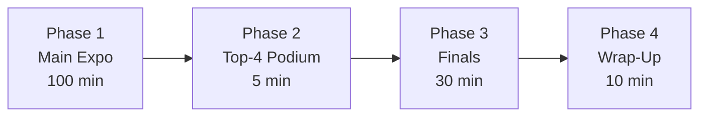
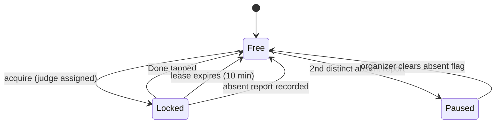
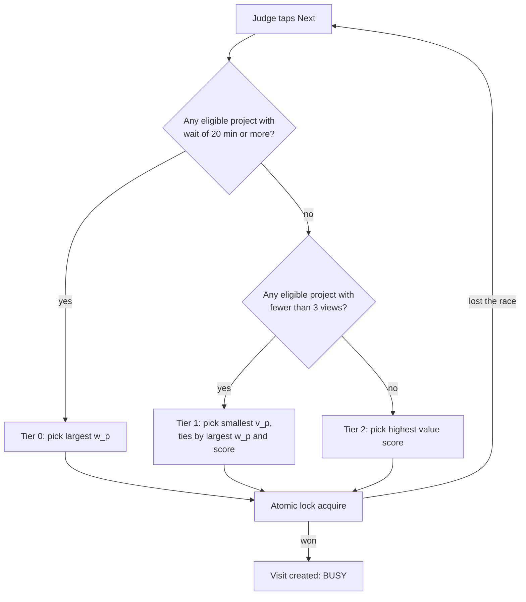

# Judging System

This document explains how HackKU judging works: first as a high-level overview for organizers and contributors, then as a technical reference covering the routing algorithm, the ranking math, and the data model.

| Concern | Source of truth |
| :--- | :--- |
| Judge-facing actions (lock, visit, absent, submit) | [`app/actions/judging/judge.ts`](../app/actions/judging/judge.ts) |
| Admin actions | [`app/actions/judging/admin.ts`](../app/actions/judging/admin.ts) (empty) |
| Tables | [`db/schema.ts`](../db/schema.ts): `judgeInfo`, `challenge`, `project`, `projectVisit`, `judgePodium` |
| Lock lease length | `judgeLockDuration` in [`constants.ts`](../constants.ts) |
| Permissions | `judging` resource in [`lib/auth/permissions.ts`](../lib/auth/permissions.ts); see [auth.md](./auth.md) |


---

# Part 1: Overview

## The Core Idea: Smart Shortlisting, Human Finals

Judging hundreds of projects across two rooms with a limited number of judges means no judge can see everything, and judges disagree about what a "good" score is. The system splits the problem in two:

| Who | Job |
| :--- | :--- |
| **Software** (Phases 1 and 2) | Route judges to tables without collisions, collect *comparisons* (which erase harsh/generous grader bias), and narrow each room to a small **finalist shortlist**. |
| **Humans** (Phase 3) | A fresh panel visits only the finalists back-to-back and decides 1st, 2nd, and 3rd. |

The software never picks a winner on its own. Its goal is that **the true winners are very likely on the shortlist**. Planning simulations suggested a Top 4 to 5 shortlist captures the true winners 90 to 98% of the time; those simulations have not been reproduced in this repository, so treat that as a target to validate (see [Open Questions](#open-questions)).

## Vocabulary

| Term | Meaning |
| :--- | :--- |
| **Track** | One of two judging rooms, `GENERAL` or `THEME`. Every project and every track judge belongs to exactly one. |
| **Hackathon Challenge** | A prize category (not sponsor-run) that teams from *either* room can enter. Scored with a rubric, see [Challenge Rubric](#challenge-rubric). |
| **Sponsor Challenge** | A sponsor-run prize. Sponsors visit projects but record scores in their own system. |
| **Visit** | One judge (or sponsor) at one project, from assignment until "Done". |
| **Table lock** | A rule that only one judge or sponsor may be at a table at a time. |
| **Podium** | A judge's personal Top 4 among the projects they visited. |
| **Finalist** | A project advanced to Phase 3. |

## Timeline



| Phase | Duration | Participants | What happens |
| :--- | :--- | :--- | :--- |
| **1. Main Expo** | 100 min | Track judges, sponsors | Judges are routed table to table (about 5 min pitch plus 1 min walk) and compare each project to the one before. Sponsors visit their challenge entrants through the table locking but with no scoring. |
| **2. Top-4 Podium** | 5 min | Track judges | Each judge drags their 4 favorite visited projects onto a podium. The system computes the shortlists. |
| **3. Finals** | 40 min | Track panels, challenge panels | A fresh 3-person panel per room visits that room's 4 finalists and picks 1st to 3rd. Separate challenge panels visit the finalists for each Hackathon Challenge. |
| **4. Wrap-Up** | 10 min | Organizers | Confirm winners, resolve disqualification flags, finalize ceremony slides. |

## What Each Participant Sees

**Track judges**

1. Tap to receive a table. Only that table is locked to them.
2. After the pitch, starting from their second table, tap one of four buttons: **Much Worse**, **Slightly Worse**, **Slightly Better**, **Much Better** compared with the table they just left. A one-line private note is optional.
3. If the team entered a Hackathon Challenge, answer two quick factual toggles (see [Challenge Rubric](#challenge-rubric)).
4. Tap **Done**. The next table is assigned.
5. When the expo ends, drag a Top 4 onto the podium.

**Sponsors** see only the teams that entered their challenge and a single **Next Project** button. There is nothing to score.

**Organizers** get an admin dashboard that warns before the expo if a challenge has too many entrants for its sponsor representatives, resolves absent teams, and handles the Phase 4 checks.

## Fairness Guarantees

| Risk | How the design handles it |
| :--- | :--- |
| A harsh or generous judge skews scores | Judges give **relative** judgments between two tables, so a judge's personal baseline cancels out. |
| One room is judged more generously than the other | Rankings are computed **within each room only**. Cross-room comparison is done by humans in the finals. |
| Challenge scores tie at 5.0 | Challenges use a coarse **factual rubric** instead of a 1 to 5 scale, adjusted for judge leniency. |
| Two judges stand at the same table | Table locks. |
| A team is never seen | A minimum-views floor and a 20-minute anti-starvation rule. |
| An absent team stalls the room | Two independent absent reports pause routing to that table. |
| A judge compared two great projects only indirectly | The Top-4 podium links non-adjacent tables. |
| A tech-less entry wins a tech challenge | Two judges flagging an entry triggers an organizer check. |

---

# Part 2: Technical Reference

## Phase 1: Routing

### Table Locks

A table is either free or held by exactly one judge under a time-limited **lease**.



The lease (`judgeLockDuration`, currently 10 minutes) is roughly twice the expected 5-minute pitch, so a judge who forgets to tap **Done** does not strand a table for the rest of the expo.

Acquiring a lock must be a **single atomic conditional write**, not read-then-write. In pseudo-SQL:

```sql
UPDATE project
SET    current_judge_id = :judge,
       judge_lock_expires_at = now() + :lease
WHERE  id = :project
  AND  NOT is_absent
  AND  (current_judge_id IS NULL OR judge_lock_expires_at <= now());
-- success  <=>  exactly one row updated
```

Otherwise two judges can both pass the "is it free?" check and both take the table. A judge holds at most one lock at a time.

### Visit Lifecycle

Each visit is a row that moves `BUSY` to `COMPLETED` (judged and released) or `ABSENT` (table empty). Only `COMPLETED` visits count as **views** and as comparison endpoints. Visits have a type: `TRACK` or `SPONSOR`.

A judge's **previous project** is their most recent `COMPLETED` visit. It must be derived on the server, never trusted from the client. An absent table does not break the chain; the next table is compared against the last table the judge actually judged.

### Choosing the Next Table

Let `E_j` be judge *j*'s **eligible set**: projects in the judge's track that are not absent, not currently locked, and not yet visited by *j*. For project *p* at time *t*:

* $v_p$ = number of completed visits.
* $w_p = t - \text{last visit time}$ (measured from expo start if never visited).

The router picks the next table by strict priority:



1. **Tier 0, anti-starvation:** any eligible team that has waited 20 minutes or more goes first, longest wait first.
2. **Tier 1, minimum views:** every project gets at least 3 views before judges are steered toward contenders.
3. **Tier 2, information value:** once the floor is met, send judges where an extra comparison teaches the model the most.

If the best candidate is taken by another judge between selection and lock, the router falls through to the next candidate. If the eligible set is empty (everything locked), the judge sees a short wait state and the router retries. No new assignments are made after $t_{\text{end}} - 6$ minutes, so every visit finishes before the expo closes.

> [!TIP]
> Within each tier, break near-ties (within about 5%) at random. Without jitter, judges who finish together are all sent to the same "best" table, and everyone's visiting order becomes correlated.

#### The Tier 2 value score

Tier 2 treats the problem as **adaptive top-*K* identification** (the idea behind LUCB-style bandit algorithms): we do not need an accurate score for every project, only to know which ones belong in the top. Two ingredients multiply together:

$$
\text{value}(p \mid \text{prev}) \;=\; \underbrace{\bigl(\varepsilon + 4\,q_p(1-q_p)\bigr)}_{\text{boundary uncertainty}} \;\times\; \underbrace{4\,\sigma(\Delta)\bigl(1-\sigma(\Delta)\bigr)}_{\text{comparison informativeness}}, \qquad \Delta = \hat\theta_p - \hat\theta_{\text{prev}}
$$

* $q_p$ is the model's current probability that $p$ is in the room's true top 3 (defined in [Shortlist Selection](#shortlist-selection)). The term $4q_p(1-q_p)$ is $1$ when we are maximally unsure and $0$ for projects that are clearly in or clearly out. $\varepsilon$ (for example $0.05$) keeps clear cases from being starved entirely.
* $\sigma$ is the logistic function. A comparison between two projects of nearly equal quality ($\Delta \approx 0$) is the most informative, because the outcome is closest to a coin flip. This is the Fisher information of a logistic comparison, scaled to $[0,1]$.
* Optional additions: a bonus for pairs nobody has compared yet, and a small proximity bonus using `project.location` to shorten walks.

Because the model is refit periodically (about once a minute is plenty), the router always reads a slightly stale but consistent snapshot.

#### Connectivity

A chain of comparisons only ranks two projects relative to each other if there is a path of comparisons between them. The comparison graph (projects as nodes, comparisons as edges) must be **connected within each room**. The 3-view floor makes this very likely, and the router can verify it with a union-find structure. If the graph is split into components, prefer candidates that bridge two components before using Tier 2.

### Absent Teams

* A judge who arrives at an empty table taps **Absent**. The visit becomes `ABSENT`, the lock is released, and the visit does **not** count as a view.
* The project is paused (`isAbsent = true`) only after **two distinct judges** report it. One report is weak evidence: a judge may simply be at the wrong table.
* Organizers can clear the flag if the team returns.

If a single judge is wrong about 10% of the time and errors are independent, the chance that at least 2 of 3 visiting judges are wrong is $3(0.1)^2(0.9)+(0.1)^3 = 0.028$, so requiring two reports cuts false pauses by roughly a factor of three.

### Capacity

With $J$ judges in a room, each completing about $n$ visits, and $N$ projects, the average views per project is

$$
\bar v = \frac{J\,n}{N}.
$$

The minimum-views floor is only achievable if $J\,n \ge 3N$. With about 13 visits per judge, a room needs at least $3N/13$ judges (for example, 10 judges for up to 43 projects). The admin dashboard should check this **before** the expo and warn if it fails.

### Sponsor Routing

Sponsors use the same lock and visit machinery with `type = SPONSOR`, with these differences:

* The eligible set is limited to projects whose `challengeIds` contain the sponsor's `sponsorAssignment`.
* There is no scoring UI, no comparison, and no minimum-views floor. The goal is that **each entrant is visited once** by a representative of that challenge.
* Capacity: one representative can see about 15 teams in 100 minutes, so a challenge with $N_c$ entrants needs $\lceil N_c / 15 \rceil$ representatives. When more than one is needed, the entrant list is split into disjoint partitions (for example by `location`) so representatives do not duplicate effort.

## What Judges Record

### Track Comparison

Starting from their second completed table, a judge compares the current project $a$ with the previous project $b$. The four buttons are stored as an integer on the visit's `rating` field:

| Button | `rating` | Meaning |
| :--- | :---: | :--- |
| Much Worse | `-2` | $a$ is much worse than $b$ |
| Slightly Worse | `-1` | $a$ is slightly worse than $b$ |
| Slightly Better | `+1` | $a$ is slightly better than $b$ |
| Much Better | `+2` | $a$ is much better than $b$ |

There is intentionally no "same" option. It forces a direction and keeps the likelihood simple. The first table has `rating = null`, because there is nothing to compare against, and serves as the chain's anchor.

### Challenge Rubric

For a Hackathon Challenge entry, the track judge also taps two factual toggles, stored per challenge in `challengeRatings`:

| Dimension | 0 | 1 | 2 |
| :--- | :--- | :--- | :--- |
| **Integration** | Superficial / None | Solid Use | Central Pillar of Project |
| **Execution** | Mocked / Broken | Functional | Standout Implementation |

A 1 to 5 star scale is deliberately avoided. Teams from both rooms enter the same challenges, so star averages would reward whichever room had more generous judges and would produce many tied 5.0s. A three-level factual rubric is easier for judges to answer consistently, and the leniency adjustment below handles the rest.

## Phase 2: The Top-4 Podium

Adjacent-table comparisons have a blind spot: a judge who saw a great project at 1:00 PM and another at 2:15 PM never compared them. At the end of the expo, each judge drags their **4 favorite visited projects** into ranks 1 to 4.

* Judges reliably remember their top 3 or 4, not whether their 10th table beat their 11th. Limiting the task keeps it under 2 minutes.
* The podium links every pair in the top 4, and implicitly ranks those four above everything else the judge saw.
* A judge who visited fewer than 4 projects ranks all of them. A missing podium is allowed; it simply contributes no evidence.

## Ranking Model

Rankings are computed **separately for each room**. A judge only ever sees projects in their own track, so no comparison crosses rooms and no cross-room calibration is needed or attempted.

### Notation

| Symbol | Meaning |
| :--- | :--- |
| $\theta_p$ | Latent quality of project $p$ (higher is better). Only differences matter. |
| $\Delta = \theta_a - \theta_b$ | Quality gap between the current project $a$ and previous project $b$. |
| $\kappa_j$ | How large a gap judge $j$ needs before saying "Much" instead of "Slightly". |
| $V_j$ | The set of projects judge $j$ completed. |
| $\pi_{j,1},\dots,\pi_{j,4}$ | Judge $j$'s podium, best first. |

### Comparison Likelihood

Each comparison is modelled as an **ordered logistic** (cumulative-link) response on the quality gap. With $\sigma(x) = 1/(1+e^{-x})$:

| Response | Probability |
| :--- | :--- |
| Much Better | $\sigma(\Delta - \kappa_j)$ |
| Slightly Better | $\sigma(\Delta) - \sigma(\Delta - \kappa_j)$ |
| Slightly Worse | $\sigma(\Delta + \kappa_j) - \sigma(\Delta)$ |
| Much Worse | $1 - \sigma(\Delta + \kappa_j)$ |

The thresholds are symmetric around $0$ (there is no "same" option), so a single parameter $\kappa_j$ describes the judge. As $\kappa_j \to \infty$ the model collapses to the simple Bradley-Terry win probability $\sigma(\Delta)$.

**Worked example.** Take $\kappa = 1$ and a project that is truly $0.5$ better than the previous one ($\Delta = 0.5$):

| Response | Probability |
| :--- | :---: |
| Much Better | 0.378 |
| Slightly Better | 0.245 |
| Slightly Worse | 0.195 |
| Much Worse | 0.182 |

Even though the project is better, "worse" is reported 38% of the time. A single comparison is noisy by design; the model's job is to combine many.

### Why Judge Bias Cancels

A harsh judge shifts every absolute score they would give by some constant $b_j$. A comparison only sees the **difference** between two of that judge's own judgments, $(\theta_a + b_j) - (\theta_b + b_j) = \theta_a - \theta_b$, so $b_j$ drops out. What remains is how generously a judge uses the word "Much" ($\kappa_j$), which is estimated with a prior (below).

### Podium Likelihood

Each podium is a partial ranking and enters as a **Plackett-Luce** likelihood. Each position is a "choose the best of what remains" event:

$$
\prod_{m=1}^{\min(4,|V_j|)} \frac{e^{\theta_{\pi_{j,m}}}}{\sum_{q \in V_j \setminus \{\pi_{j,1},\dots,\pi_{j,m-1}\}} e^{\theta_q}}
$$

The denominator contains every project the judge visited that is not already placed, so the podium also encodes "these four beat the rest".

### Fitting

The estimate $\hat\theta$ maximizes the log posterior

$$
\mathcal{L}(\theta) \;=\; \sum_{\text{comparisons}} \log P(c \mid \theta_a-\theta_b,\kappa_j) \;+\; w \sum_{j}\sum_{m} \log \text{PL}_{j,m}(\theta) \;-\; \frac{\lambda}{2}\lVert\theta\rVert^2 .
$$

* The last term is a Gaussian prior ($\theta_p \sim \mathcal{N}(0, 1/\lambda)$). It **shrinks** projects with few observations toward the room average, so one lucky pair of "Much Better" votes cannot catapult a project to first.
* $w$ weights the podium relative to the pairwise comparisons. A podium is a deliberate, memorable judgment, so $w \ge 1$ is reasonable.
* $\mathcal{L}$ is **concave** in $\theta$ for fixed $\kappa_j$, because log-ordered-logistic, log-softmax, and the quadratic penalty are all concave. Newton's method therefore converges to the unique global optimum and cannot get stuck in a local one.
* Each $\kappa_j$ gets a log-normal prior centered on a global $\kappa_0$ ($\log\kappa_j \sim \mathcal{N}(\log\kappa_0, \sigma_\kappa^2)$) and is re-estimated by alternating with $\theta$. Judges with fewer than about 5 comparisons use $\kappa_0$ directly.

A room has tens of projects, so a fit is a few small Newton steps and runs in milliseconds.

### Uncertainty

Ranking by $\hat\theta$ alone hides how sure we are. At the optimum, a Laplace approximation gives the posterior covariance

$$
\Sigma \;\approx\; \bigl(-\nabla^2 \mathcal{L}(\hat\theta)\bigr)^{-1},
$$

which exists because the prior makes the Hessian positive definite. A back-of-the-envelope view: one logistic comparison carries at most $1/4$ Fisher information about a gap, so a project with $d$ incident comparisons has a standard error of roughly $1/\sqrt{0.2\,d}$. With 3 to 4 views (about 6 to 8 comparisons), that is around $0.9$ logit units, which is comparable to the whole spread of project quality. **One expo pass cannot reliably order projects**, which is exactly why the output is a shortlist and not a podium.

### Shortlist Selection

1. Draw $M$ samples (for example $M = 2000$) $\theta^{(s)} \sim \mathcal{N}(\hat\theta, \Sigma)$.
2. For each sample, rank the room. Let
   $$ q_p = \frac{1}{M}\sum_{s=1}^{M} \mathbf{1}\bigl[\text{rank}_s(p) \le 3\bigr] $$
   be the probability that $p$ is truly in the top 3. Note $\sum_p q_p = 3$.
3. **Finalists** are the 4 projects with the highest $q_p$. Add a 5th if the shortlist's expected capture, $\sum_{p \in S} q_p / 3$, is below 95%. Never exceed 5, because panel time is fixed.

Selecting by $q_p$ rather than by $\hat\theta$ matters. A project with a middling score but huge uncertainty may deserve a slot over a slightly higher but well-measured one.

## Challenge Scoring

Hackathon Challenge entries are ranked **within each room** from the rubric scores, and the top 3 of each room advance (6 finalists per challenge). If a room has 3 or fewer entries, all advance.

For each rated entry define a score $y_{jp} = I_{jp} + X_{jp}$ (Integration plus Execution, range 0 to 4; the weights are tunable). A judge's leniency is separated from the project's quality with a **mixed-effects (random-effects) model**:

$$
y_{jp} = \mu + u_j + v_p + \epsilon_{jp}, \qquad u_j \sim \mathcal{N}(0,\sigma_u^2),\; v_p \sim \mathcal{N}(0,\sigma_v^2),\; \epsilon \sim \mathcal{N}(0,\sigma^2)
$$

* $u_j$ is judge $j$'s leniency, shared across all of that judge's rated entries.
* $v_p$ is the project's quality for that challenge.
* The estimates are the **BLUP** (best linear unbiased predictor), which is a ridge regression:

$$
\min_{\mu,u,v}\; \sum_{(j,p)} (y_{jp}-\mu-u_j-v_p)^2 \;+\; \frac{\sigma^2}{\sigma_u^2}\sum_j u_j^2 \;+\; \frac{\sigma^2}{\sigma_v^2}\sum_p v_p^2 .
$$

The shrinkage terms mean a project rated by one lenient judge is pulled back toward the average more than a project rated by three judges. Entries are ranked by $\hat v_p$ and ties are broken by higher mean Execution, then by the track model's $\hat\theta_p$.

> [!NOTE]
> Scores are only compared **within a room**. Comparing a General entry against a Theme entry is left to the human challenge panel, which sees both side by side. This is what makes the cross-room split fair without cross-room calibration.

A team that entered several challenges is rated on each separately, so one visit can record several rubric answers.

### Disqualification Flag

If **two or more distinct judges** rate an entry's Integration as `0` (Superficial / None) for a challenge, the entry is flagged for an organizer check, before prizes are announced. As with absent reports, requiring agreement filters out a single judge's misjudgment: with a 10% independent false-flag rate per judge, two or more flags from three judges happen only about 2.8% of the time by chance.

## Phase 3: Finals

### Track Finals

A panel of fresh evaluators (organizers or judges who have not seen these projects) visits the room's 4 finalists and decides 1st, 2nd, and 3rd. The panel moves as a unit and takes one lock per table.

### Challenge Finals

A small challenge panel visits the 4 finalists (2 per room) for each Hackathon Challenge and picks the winner. Sponsor Challenge winners are decided by the sponsor and are outside this system.

### Finals Scheduling

A project can be a finalist for its track **and** several challenges, so panels compete for the same tables. Panels claim tables through the same lock router, picking the unlocked, unvisited finalist with the **most remaining demand** (the most other panels still needing it), which is the standard most-constrained-first heuristic for this kind of open-shop scheduling.

With visit time $\tau$ (5 minute pitch plus 1 minute walk gives $\tau = 6$), a panel $\pi$ needing tables $F_\pi$ and a table $t$ needed by $d_t$ panels, the finals cannot finish before

$$
T_{\min} \;=\; \tau \cdot \max\Bigl(\max_\pi |F_\pi|,\; \max_t d_t\Bigr).
$$

## Phase 4: Wrap-Up

Organizers confirm each panel's result, resolve disqualification flags, and finalize slides. Admin tooling should show the track results, each challenge's results, and every flagged entry in one place.

---

## Data Model Reference

### `judgeInfo`

One row per judge or sponsor representative (unique on `userId`).

| Field | Type | Description |
| :--- | :--- | :--- |
| `userId` | `string` | Foreign key to `user`. |
| `track` | `EventTrack?` | `GENERAL` or `THEME`. Required for track judges. |
| `sponsorAssignment` | `string?` | Foreign key to `challenge`. Set for sponsor representatives. |
| `isPresent` | `boolean` | Whether the judge has checked in. Only present judges should be routed. |

### `challenge`

| Field | Type | Description |
| :--- | :--- | :--- |
| `id` / `name` / `description` | `string` | Identity and display. |
| `isSponsor` | `boolean` | `true` for Sponsor Challenges (no rubric), `false` for Hackathon Challenges. |

### `project` (judging fields)

| Field | Type | Description |
| :--- | :--- | :--- |
| `track` | `EventTrack?` | The room the team is judged in. |
| `challengeIds` | `string[]?` | Challenges the team entered. |
| `location` | `string?` | Table location. |
| `currentJudgeId` | `string?` | Lock holder. |
| `judgeLockExpiresAt` | `timestamp?` | Lock lease expiry. |
| `isAbsent` | `boolean` | Routing is paused for this table. |

### `projectVisit`

| Field | Type | Description |
| :--- | :--- | :--- |
| `judgeId` | `string` | The visiting judge. |
| `currentProjectId` | `string` | The visited project. |
| `previousProjectId` | `string?` | The comparison baseline (null for a judge's first table). |
| `rating` | `integer?` | Comparison result, `-2`, `-1`, `+1`, `+2`. |
| `comment` | `string?` | Private note. |
| `challengeRatings` | `json?` | Rubric answers keyed by challenge ID. |
| `type` | `ProjectVisitType` | `TRACK` or `SPONSOR`. |
| `status` | `ProjectVisitStatus` | `BUSY`, `COMPLETED`, or `ABSENT`. |

### `judgePodium`

| Field | Type | Description |
| :--- | :--- | :--- |
| `judgeId` / `projectId` | `string` | The judge and the project they ranked. |
| `rank` | `integer` | 1 to 4. Unique per judge, and a project may appear once per judge. |

### Needed but not yet modelled

| Need | Why |
| :--- | :--- |
| Finals visit types and results | `ProjectVisitType` has only `TRACK` and `SPONSOR`; finals need their own types plus a table recording each panel's 1st, 2nd, and 3rd. |
| Panels | Finals evaluators are groups, not single judges. |
| Phase and timer configuration | Phase start and end times drive the router cutoffs. |
| Ranking snapshots | Caching $\hat\theta$, $q_p$, and shortlists keeps the router and dashboard fast and auditable. |
| Visit uniqueness | A unique index on (`judgeId`, `currentProjectId`) would prevent duplicate visits. |
| Rubric shape | `challengeRatings` is typed `Record<string, number>`, but each challenge needs two values (`integration`, `execution`). |

## Authorization

| Role | Grant | Used for |
| :--- | :--- | :--- |
| `judge` | `judging:participate` | Lock, visit, absent, and submit actions. |
| `volunteer` | `judging:view` | Read-only monitoring. |
| `admin` | `judging:manage`, `judging:view` | Dashboard, overrides, shortlists. |

Every action follows the standard guard order from [auth.md](./auth.md#enforcing-access-in-code). Sponsor roles (`bronze_sponsor`, `silver_sponsor`, `gold_sponsor`) currently hold no `judging` grant, so sponsor routing has no permission to use yet.

---

## Implementation Status

| Piece | Status |
| :--- | :--- |
| Schema (`judgeInfo`, `challenge`, `project`, `projectVisit`, `judgePodium`) | Done |
| Lock, unlock, absent, and submit actions | Prototype, with defects below |
| Router, ranking model, shortlists | Not started |
| Podium, finals, and Phase 4 flows | Not started |
| Admin actions and dashboard | Not started (`admin.ts` is empty) |

### Defects in `judge.ts`

| Severity | Issue | Location |
| :--- | :--- | :--- |
| **Critical** | Updates to `project` and `projectVisit` have **no `where` clause** in `startJudgingProject`, `unlockProject`, `markProjectAbsent`, and `judgeProject`. Each call locks, unlocks, or marks absent **every project** and rewrites **every visit** to `COMPLETED` or `ABSENT`. | [L58](../app/actions/judging/judge.ts#L58), [L110](../app/actions/judging/judge.ts#L110), [L164](../app/actions/judging/judge.ts#L164), [L249](../app/actions/judging/judge.ts#L249) |
| **Critical** | `judgeProject` updates the visit with `where currentProjectId` only, so it overwrites every judge's visit to that project. It must also filter by `judgeId` and `status = BUSY`. | [L253-L261](../app/actions/judging/judge.ts#L253-L261) |
| High | The lock check is read-then-write, so two judges can acquire the same table at once. Use the atomic conditional update described in [Table Locks](#table-locks). | [L50-L67](../app/actions/judging/judge.ts#L50-L67) |
| High | `judgeProject` requires the **previous** project to still be locked by the judge, but it was released when that judge finished it. The check fails for every judge after their first table. | [L244-L246](../app/actions/judging/judge.ts#L244-L246) |
| High | `judgeProject` never sets `status = COMPLETED`, and it releases the lock, so a following `unlockProject` call fails its ownership check. The two actions are not composable; merge "submit" and "release" into one transaction. | [L248-L262](../app/actions/judging/judge.ts#L248-L262) |
| High | One report marks a project absent immediately (the `TODO` asks about two). Under the 2-strike rule, derive absence from the count of distinct judges with `ABSENT` visits. | [L162-L172](../app/actions/judging/judge.ts#L162-L172) |
| Medium | `previousProjectId` is supplied by the client. Derive it on the server from the judge's last `COMPLETED` visit. | [L175-L187](../app/actions/judging/judge.ts#L175-L187) |
| Medium | No Zod validation of `rating` or `challengeRatings`, contrary to the repo's action conventions. | [L175-L187](../app/actions/judging/judge.ts#L175-L187) |
| Medium | Sessions are read without `disableCookieCache`, which the auth rules require for state-changing requests. | [L18-L20](../app/actions/judging/judge.ts#L18-L20) |
| Medium | `challenge` has no entry in `db/relations.ts` and `judgeInfo` has no relation to it, so `db.query.challenge` and relational joins do not work. `project.challengeIds` is a plain array with no referential integrity. | `db/relations.ts` |
| Low | The sponsor flow is unreachable: `startJudgingProject` requires `judgeInfo.track`, and sponsor roles lack `judging:participate`. | [L33-L35](../app/actions/judging/judge.ts#L33-L35) |
| Low | `isPresent` is never checked, and `startJudgingProject` always writes `type = TRACK` by default. | [L24-L35](../app/actions/judging/judge.ts#L24-L35) |

## Open Questions

| # | Question |
| :--- | :--- |
| 1 | **Finals duration and panel size:** 25 or 30 minutes, and 3 or 5 panelists? Can a 6-table challenge panel fit? |
| 2 | **Panel decision rule:** consensus discussion, or each member submits a full ranking aggregated by Borda count? |
| 3 | **Sponsor Challenge winners:** chosen by the sponsor outside the app, or recorded here? |
| 4 | **Flagged entries:** should an entry flagged for `Superficial / None` be removed from challenge finals before Phase 3, or only reviewed in Phase 4? |
| 5 | **Sponsor permissions:** which role and grant do sponsor representatives use for routing? |
| 6 | **Validating the 90 to 98% claim:** build a simulator (draw $\theta \sim \mathcal{N}(0,1)$ per project, simulate judges with varied $\kappa_j$ through the router, measure how often the true top 3 land in the shortlist) and use it to tune $\lambda$, $w$, $\varepsilon$, and the 95% capture target. |
| 7 | **Absent-team recovery:** how do the 2 absent strikes interact with a team that returns after the flag is set? |

## References and Inspirations

* Thurstone, L. L. (1927). *A law of comparative judgment.* Psychological Review.
* Bradley, R. A. and Terry, M. E. (1952). *Rank analysis of incomplete block designs: I. The method of paired comparisons.* Biometrika.
* Luce, R. D. (1959), *Individual Choice Behavior*; Plackett, R. L. (1975). *The analysis of permutations.* JRSS C. (the Plackett-Luce ranking model)
* McCullagh, P. (1980). *Regression models for ordinal data.* JRSS B. (ordered logistic responses)
* Chen, X., Bennett, P. N., Collins-Thompson, K., and Horvitz, E. (2013). *Pairwise ranking aggregation in a crowdsourced setting.* WSDM. (Crowd-BT, judge reliability in pairwise ranking)
* [Gavel](https://github.com/anishathalye/gavel) by Anish Athalye, an open-source hackathon judging system built on pairwise comparison.
* Kalyanakrishnan, S., Tewari, A., Auer, P., and Stone, P. (2012). *PAC subset selection in stochastic multi-armed bandits.* ICML. (LUCB, adaptive top-*K* identification)
* Henderson, C. R. (1975). *Best linear unbiased estimation and prediction under a selection model.* Biometrics. (BLUP for the leniency model)
